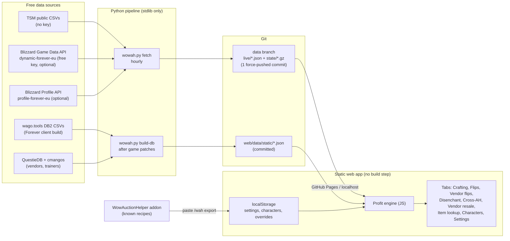

# Architecture

A personal, zero-cost auction house profit analyzer for **WoW Forever, EU, Normal ruleset**.
Constraints: free, no servers to run, nothing to host, single user.

## Big picture



Two ways to run it, with the same code:

| Mode | How | Cost |
|---|---|---|
| **GitHub (recommended)** | `update-prices.yml` runs hourly, keeps state on the `data` branch and deploys `web/` and the fresh data to GitHub Pages | Free on your plan (about 1 Actions minute per run) |
| **Local** | `python wowah.py run` fetches, then serves `web/` on `http://localhost:8000` | Free |

## What WoW Forever changes (as of Nov 2026)

* **No realms.** Characters pick a *ruleset* (Normal / PvP / RP / RP-PvP) that acts like one big realm per region. API namespaces are `dynamic-forever-eu`, `static-forever-eu` and `profile-forever-eu`.
* **Auction houses** are served under `/data/wow/ruleset/{id}/auctions/` (the trailing slash is required): one Alliance, one Horde and one neutral Blackwater house per ruleset, split into item auctions and `/commodities`. The API does not label which house belongs to which ruleset. The community mapping for EU Normal is **111 / 114 / 117**, and `python wowah.py houses --check` verifies it against TSM.
* **Recipes differ from Classic Era 1.15.** There are about 600 new or changed recipes, a new Camping category, and some moved professions: Major Healing Potion is now **First Aid** and takes Soothing Spices. That is why the recipe DB is built from the **Forever client build** (`wowf` on wago.tools), not from classic data.
* The client is **retail-engine based**: interface 16001, `C_TradeSkillUI`, `C_AuctionHouse`, and no getAll scan. The addon only reads professions and known recipes; it does not scan the AH.

## Data sources

| Data | Source | Key needed | Refresh |
|---|---|---|---|
| Per-faction market value, min buyout, 60-day historical | TSM public data `forever/eu/realm/normal-{alliance,horde}/items.csv` | no | about every 1–3 h |
| EU-wide sold/day, sale rate, avg sale price | TSM `forever/eu/region/items.csv` | no | daily |
| Every listing (quantities, price ladder), Blackwater house, own history and sales estimates | Blizzard API | free client id/secret | hourly |
| Character professions (and known recipes if Blizzard fills them) | Blizzard Profile API `/profile/wow/character/{name}-{surname}/professions` | same key | on logout |
| Exact known recipes | WowAuctionHelper addon (paste or SavedVariables) | no | when you open profession windows |
| Recipes, reagents, skill-up levels, recipe items, item info | wago.tools DB2 CSVs for the latest `wowf` build | no | on game patch |
| Vendor-sold items, vendor NPCs, faction and zone | QuestieDB Forever data and corrections | no | on demand |
| Limited vendor stock, trainer skill levels | cmangos classic-db | no | on demand |
| Disenchant tables | vanilla tables (cmangos), brackets confirmed by Forever's ItemDisenchantLoot | — | static |

TSM alone is enough to use the app. Blizzard keys add listing depth, so the app can tell how many units sit below a price, plus the neutral AH and your own price history.

## Repository layout

```
wowah.py                 CLI: fetch | serve | run | build-db | houses
pipeline/
  config.py              defaults (EU / forever / normal / houses 111,114,117) + config.json + env
  blizzard.py            OAuth client-credentials + Forever ruleset/auction/profile endpoints
  tsm.py                 TSM public CSV reader
  aggregate.py           snapshot -> per-item min / market (cheapest 15%) / median / qty / ladder
  history.py             rolling daily history + "disappeared auctions" sales estimate
  fetch.py               merges TSM + Blizzard -> web/data/live/house-<slug>.json
  characters.py          Profile API -> characters.json
  houses.py              list houses and verify the house mapping against TSM
  build_db.py            wago.tools + QuestieDB + cmangos -> web/data/static/*.json
  luadata.py             small Lua table parser (QuestieDB)
web/                     static app, ES modules, no dependencies
  js/engine/prices.js    PriceBook: buy cost / sell value per item, price sources, AH cut, vendor
  js/engine/crafting.js  recipe profit, recursive intermediates, skill colors, status per character
  js/engine/opportunities.js  flips, vendor flips, disenchant, cross-AH, vendor resale
  js/character.js        addon import (paste / SavedVariables) -> characters
  js/lua.js              SavedVariables parser
  js/app.js, ui.js       UI
  data/static/           committed game DB
  data/live/             generated prices (git-ignored; on Pages it comes from the data branch)
addon/WowAuctionHelper/  in-game exporter (/wah)
tests/                   node --test (engine) + python unittest (pipeline)
.github/workflows/       update-prices.yml (hourly), build-db.yml (manual)
```

## Data formats

`web/data/live/house-<alliance|horde|neutral>.json`
```jsonc
{
  "fields": ["min","market","now","hist","qty","auctions","soldPerDay","saleRate","avgSale"],
  "items":  {"13446": [2369, 3620, 2370, 2981, 340, 12, 138.0, 0.62, 3133]},
  "ladder": {"13446": [[2369, 5], [2400, 20], ...]},   // Blizzard only: cheapest price levels
  "spark":  {"13446": [3500, 3610, ...]},              // Blizzard only: daily market history
  "sources": {"tsm": 1794896333, "tsmRegion": 1794788103, "blizzard": 1794913572}
}
```
Merge rules: `min` and `qty` come from Blizzard when it is configured (it is newer), otherwise from TSM. `market` is TSM's 14-day market value. `now` is Blizzard's cheapest-15% average or TSM's `recent`. `hist` is TSM's 60-day value, or else the median of our own daily history. Sale stats come from TSM's region data, or else our own estimate.

`web/data/static/recipes.json`: one entry per recipe spell:
```jsonc
{"id":1244436,"n":"Major Healing Potion","p":"firstaid","cat":"Healing Potions","out":13446,"q":[1,1],
 "r":[[8925,1],[3713,3],[13464,1]],"s":[275,290,310,330],"sk":"exact","src":"item","ri":255729}
```
`s` = [learn (orange), yellow, green, grey]. The learn level comes from the recipe item's required skill or the cmangos trainer data. When neither has it, it is estimated as yellow − 20 and `sk` is set to `"approx"`.

## Profit engine (browser)

All maths runs client-side, so changing a filter or setting is instant and needs no backend.

* **PriceBook** holds one per auction house.
  * `buyCost(item)` = the cheapest of your override, a vendor (if a vendor friendly to your faction sells it) and the AH at the chosen price source.
  * `sellNet(item)` = max(AH price × (1 − cut), vendor sell price).
  * The cut is 5% at faction houses and 15% at Blackwater. Both are configurable.
* **Crafting**
  1. Unit costs are computed with a Bellman-Ford-style relaxation: an item's cost is min(buy, craft from the cheapest reagents) / average yield. This lets intermediates such as bars, bolts and transmutes be crafted when that is cheaper, handles cycles safely, and can be limited to recipes your characters can make.
  2. Profit = net sale value × yield − cost.
  3. **Expected profit** = profit × TSM sale rate. This liquidity-aware ranking stops items that never sell from topping the list.
  4. Per character: status (known / trainer / needs recipe / skill too low), skill-up colour, skill-up chance ((grey − skill) / (grey − yellow)) and **cost per skill-up** for levelling.
* **Flips**: listings at least X% below the reference value (market or historical). With Blizzard data the ladder gives the quantity and the "buy up to" price.
* **Vendor flips**: AH listings priced under the NPC vendor sell price.
* **Disenchant**: the expected value of the mats (vanilla DE tables × mat prices after the cut), compared with the item's AH price, filtered by your enchanting skill. Items flagged no-disenchant are skipped.
* **Cross-AH**: buy in one house and sell in another (faction ↔ Blackwater, or Alliance ↔ Horde through an alt).
* **Vendor resale**: items vendors sell, including limited-supply recipes, that go for more on the AH, with where to buy them.

Opportunity tabs sell at the **conservative** price by default: the lowest of market, latest, historical and average sale price. That way thin markets with silly listings don't produce fake profits.

## Characters

The app combines three sources:
1. **Blizzard Profile API**: set `"characters": ["name-surname"]` or the repository variable `WOWAH_CHARACTERS`. The professions and skill levels arrive automatically, but only after the character reaches level 10 and logs out.
2. **Addon**: `/wah` shows a copy-paste export string, or you can upload the SavedVariables file. This gives the exact known recipe ids. Profession detection uses skill-line ids, so it works in any client language.
3. **Manual**: enter skill levels per profession. Every trainer recipe up to that skill then counts as craftable.

## Hourly job and storage

`update-prices.yml`:
1. Checks out `main`.
2. Restores the `data` branch into `_data/`, which holds the previous snapshot and the history.
3. Runs `wowah.py fetch`.
4. Force-pushes `_data/` as a single commit, so the repo never grows.
5. Deploys `web/` plus `_data/live` to Pages.

A run takes about 1 minute. Hourly runs come to roughly 750 minutes a month.

The Pages site of a private repo is still publicly reachable by anyone with the URL. It contains only prices and the game DB. Secrets stay in GitHub Actions secrets.

## Known limitations and ideas

* TSM sale stats are **EU-wide across all rulesets**. Treat sold/day as relative liquidity, not as your exact market.
* Without Blizzard keys there is no listing depth, so quantities are unknown, and there is no Blackwater data.
* Deposits are not subtracted. They are refunded on sale, but expired auctions lose them.
* The house mapping 111/114/117 is community-derived. Verify it with `wowah.py houses --check` once you have keys.
* About 100 recipes have an estimated learn level (`sk: "approx"`).
* Possible next steps:
  * a shopping-list export for TSM or Auctionator
  * a cooldown planner for transmutes and Mooncloth
  * Discord or e-mail alerts from the Action when a flip above X gold appears
  * deposit-aware expected profit
